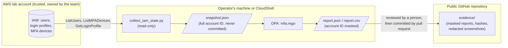

# Architecture

How the MFA configuration check is built, how data moves through it, and where the trust
boundaries are. The control under test is: every IAM user with a console password has at
least one MFA device registered.

## Components

| Component | Where | What it does |
|-----------|-------|--------------|
| Collector | `automation/mfa_checker/collect_iam_state.py` | Reads IAM state with read-only calls and writes a JSON snapshot. Refuses to run in any account other than the approved one. |
| Policy | `automation/mfa_checker/policy/mfa.rego` | Open Policy Agent (OPA) rule that decides COMPLIANT, NON_COMPLIANT, or NOT_APPLICABLE for each user in a snapshot. |
| Runner | `automation/mfa_checker/run_check.py` | Main entry point. Runs the collector, writes `snapshot.json`, calls `opa eval`, and writes `report.json` and `report.csv` with timings. |
| Validation scripts | `scripts/check_mfa_status.py`, `scripts/credential_report_check.py` | Independent cross-checks, not a second implementation. One reads the same IAM calls, the other the AWS credential report. |
| Scoring | `scripts/score_results.py`, `scripts/TestScripts/score_blind.py` | Compares results with an answer key and reports accuracy and timing. |
| Test-user scripts | `scripts/TestScripts/` | Build and remove the synthetic test users in the lab account. |

## Data flow

1. The operator runs `run_check.py` with the approved account ID and a read-only identity.
2. The collector checks the account ID first. A mismatch stops the run before any IAM call (exit code 2).
3. The collector lists users and, for each, reads whether a login profile exists and which MFA devices are registered.
4. Any AWS error stops the run and writes nothing (exit code 3).
5. The snapshot is evaluated by OPA. An OPA error stops the run (exit code 4).
6. The runner writes the report. `--mask-account-id` keeps only the last four digits of the account ID in the report files.
7. A person checks the outputs, then adds them to `evidence/` through a pull request.

## Trust boundaries

| Boundary | What crosses it | Control |
|----------|-----------------|---------|
| Operator to AWS | API calls with the scanner identity's credentials | The identity has only three read actions (`scanner-iam-policy.json`). The account ID is checked before any IAM call. |
| Collector to policy | The snapshot file | The snapshot is plain data. The policy only reads it and has no network or AWS access. |
| Local files to the public repository | Reports, screenshots, hash lists | `snapshot.json` and private outputs are in `.gitignore`. A person checks every file and screenshot before commit. Changes go through a pull request. |
| Answer key to the tester (blind test) | The key's SHA-256 hash only, until scoring | The key is hashed at build time, kept unopened, and the hash is checked again before scoring. |

## Environment and dependencies

- Python 3.13, boto3, and the `opa` binary (1.22.2 in the Run 02 and Run 03 evidence). The
  `opa` binary and the Python environment are not committed.
- Tests: pytest and moto for the end-to-end tests on simulated IAM, `opa test` for the Rego tests,
  and `unittest` for the validation scripts.
- Supported environments: AWS CloudShell, or a local machine with the tools above.

## Design decisions

See `docs/decisions/` for the recorded decisions: scoping the control to registered MFA
devices (0001), separating collection from evaluation (0002), and the rule for a password
that has never been used (0003).

## What the design does not cover

It reads registered devices. It does not test whether AWS blocks a sign-in or API call that
lacks MFA, and it describes the account only at the moment of the run.
